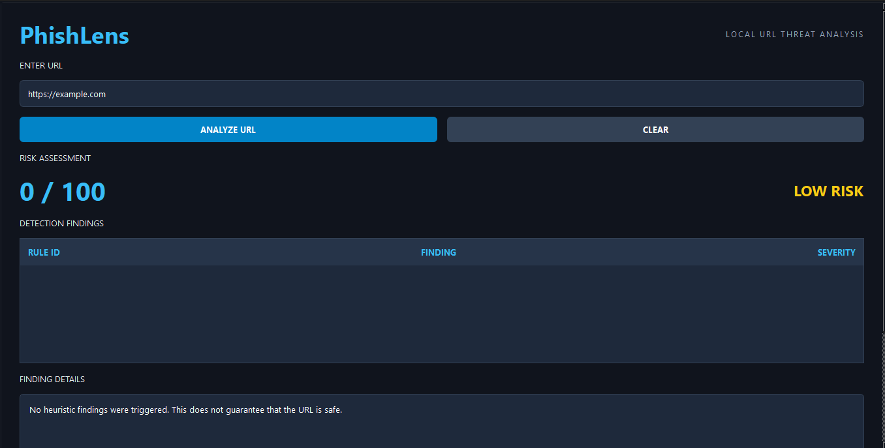
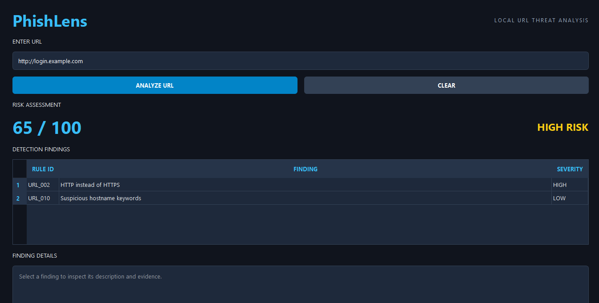

# PhishLens
### Desktop Phishing URL Analysis Application


[](https://github.com/Markkuria224/PhishLens/actions/workflows/tests.yml)

PhishLens is a Windows desktop application that performs local, heuristic-based analysis of suspicious URLs. It identifies potentially suspicious URL characteristics, explains its findings, and calculates an indicative risk score.

Built with Python and PySide6, PhishLens demonstrates practical cybersecurity concepts through an accessible desktop interface.

**PhishLens does not visit submitted URLs, perform DNS lookups, or make network requests. All analysis is performed locally.**

---

## Supported Operating Systems

| Operating System | Compatibility |
|---|---|
| Windows 11 (64-bit) | Tested and verified |
| Windows 10 (version 1809 or later, 64-bit) | Expected to be compatible; not independently tested |

**Note:** PhishLens is currently developed and tested as a Windows desktop application. Other operating systems are not officially supported.

---

## Screenshots

### Low-Risk URL Analysis



### High-Risk URL Analysis



---

## Features

- **URL Normalization:** Parses, normalizes, and validates submitted URLs.
- **Heuristic Detection:** Uses nine active rules to identify potentially suspicious URL characteristics.
- **Explainable Risk Scoring:** Calculates a weighted score from 0–100 and assigns a risk category.
- **Detailed Findings:** Presents triggered rules, severity levels, descriptions, and supporting evidence.
- **JSON Report Export:** Exports analysis results with timestamps and score breakdowns.
- **Responsive GUI:** Uses background processing to keep the interface responsive during analysis.
- **Local-Only Processing:** Does not send submitted URLs to external services or make network requests.

## Technical Skills Demonstrated

- Python application development.
- Cybersecurity fundamentals and phishing indicators.
- URL parsing, normalization, and input validation.
- Heuristic detection and risk assessment.
- GUI development using PySide6.
- Background task processing with QThread.
- Automated testing using pytest.
- JSON data handling and report generation.
- Modular software architecture and documentation.
- Privacy-conscious application design.

---

## Architecture

PhishLens uses a modular architecture with separation between URL processing, detection logic, scoring, and the graphical interface.

| Component | Responsibility |
|---|---|
| `normalizer.py` | URL parsing, normalization, and validation |
| `rules.py` | Heuristic rule definitions and finding data structures |
| `analyzer.py` | Executes detection rules and generates findings |
| `scoring.py` | Calculates weighted risk scores and assessments |
| `gui/main_window.py` | PySide6 graphical interface |
| `main.py` | Application entry point |

The analysis engine operates independently of the GUI.

For a more detailed explanation, see the [Architecture Documentation](docs/ARCHITECTURE.md).

---

## Heuristic Detection Rules

PhishLens currently implements nine active heuristic rules.

| Rule ID | Detection | Severity | Trigger |
|---|---|---|---|
| URL_001 | IP address used as hostname | High | IPv4 or IPv6 address used as hostname |
| URL_002 | HTTP instead of HTTPS | High | URL uses HTTP rather than HTTPS |
| URL_003 | Excessive subdomains | Medium | More than four subdomains |
| URL_004 | Suspiciously long URL | Low | URL exceeds 200 characters |
| URL_005 | Excessively long hostname | Low | Hostname exceeds 80 characters |
| URL_007 | Suspicious percent-encoding | Medium | Selected encoded sequences such as `%2F`, `%40`, and `%2E` appear in the path |
| URL_008 | Punycode hostname | Medium | Hostname contains the `xn--` prefix |
| URL_009 | URL-shortening service | Medium | Exact hostname matches a configured shortening service |
| URL_010 | Suspicious keywords | Low | Hostname label exactly matches a configured keyword, such as `login`, `verify`, or `wallet` |

These rules identify characteristics that may warrant further investigation. They do not independently establish malicious intent.

---

## Risk Scoring Methodology

PhishLens calculates an indicative risk score using weighted contributions from triggered findings.

### Severity Points

| Severity | Points |
|---|---:|
| Low | 10 |
| Medium | 20 |
| High | 30 |

Each finding contributes:

`Severity Points × Finding Weight`

The scoring process:

1. Calculates the contribution of each finding.
2. Retains the highest contribution when duplicate findings share the same rule ID.
3. Sums the contributions.
4. Rounds the result to the nearest integer.
5. Caps the final score at 100.

### Risk Categories

| Risk Level | Score |
|---|---:|
| Critical | 75–100 |
| High | 50–74 |
| Moderate | 25–49 |
| Low | 0–24 |

**Important:** Scoring thresholds are provisional and have not been scientifically validated.

The score is:
- Not a probability of malware infection.
- Not a definitive verdict on whether a URL is malicious.
- Not based on external threat intelligence.
- Not a substitute for security awareness or further investigation.

---

## Installation

### Prerequisites

- Windows 10 (version 1809 or later) or Windows 11.
- 64-bit operating system.
- Python 3.12 or newer.
- pip.

### 1. Clone the Repository

```powershell
git clone https://github.com/Markkuria224/PhishLens.git
cd PhishLens
```


### 2. Create a Virtual Environment

```powershell
python -m venv .venv
```

### 3. Activate the Environment

```powershell
.\.venv\Scripts\Activate.ps1
```

### 4. Install the Application

```powershell
python -m pip install -e .
```

---

## Running PhishLens

With the virtual environment activated, launch the application using either command:

```powershell
python -m phishlens.main
```

Or:

```powershell
phishlens
```

---

## Running Automated Tests

Install pytest if it is not already available:

```powershell
python -m pip install pytest
```

Run the test suite:

```powershell
python -m pytest tests/ -v
```

**Latest verified test result:** 88 tests passed.

The tests cover URL normalization, heuristic analysis, risk scoring, and selected GUI behaviours.

---

## Known Limitations

- Risk scoring thresholds are provisional and not scientifically validated.
- Heuristic detection cannot identify every phishing URL.
- Automated GUI testing covers selected behaviours; full end-to-end GUI automation is not implemented.
- No standalone Windows executable installer is currently provided.
- No SQLite scan-history database is implemented.
- No external threat intelligence integrations are included.
- Advanced internationalized domain name support remains a potential improvement.

---

## Security and Privacy Disclaimer

PhishLens performs local heuristic URL analysis. It does not establish whether a website is definitively malicious or safe.

The application:

- Treats submitted URLs as untrusted input.
- Makes no network requests or DNS lookups.
- Does not execute JavaScript or submitted content.
- Does not download files from submitted URLs.
- Does not follow redirects.
- Does not transmit submitted URLs to third-party services.

Findings indicate potential phishing characteristics and should not be treated as conclusive evidence of malicious intent.

**Exported JSON reports contain submitted and normalized URLs.** These may include sensitive information, such as authentication tokens or personal data. Store and share exported reports carefully.

---

## Future Development

Potential enhancements that are not implemented in version 1.0.0:

- Scientific validation and calibration of scoring thresholds.
- Standalone Windows executable packaging using PyInstaller.
- Expanded GUI automation testing with pytest-qt.
- Optional external threat intelligence integrations, subject to user consent.
- Local SQLite scan history.
- Additional report export formats.
- Enhanced internationalized domain name support.

---

## Project Configuration

| Property | Value |
|---|---|
| Application | PhishLens |
| Version | 1.0.0 |
| Language | Python |
| Python Requirement | >= 3.12 |
| GUI Framework | PySide6 |
| Testing Framework | pytest |
| Build Backend | setuptools |
| Package Discovery | `src/` |
| Application Dependencies | PySide6 >= 6.0 |

---

## Ownership and Usage

Copyright (c) 2026 Mark Kuria.

All rights reserved.

This repository is publicly available for viewing and evaluation. No general license is granted to reuse, modify, distribute, or commercially exploit the source code.

See the [LICENSE](LICENSE) file for the full ownership and usage notice.

---

**PhishLens 1.0.0 — A practical exploration of local phishing URL analysis using Python.**